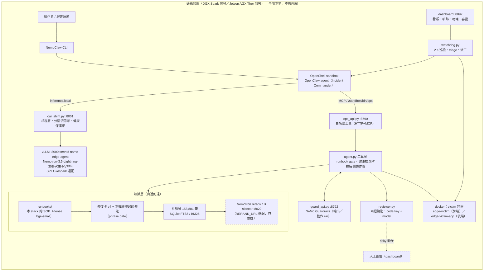

# Blackout Ops — 離線自我修復的 IT 維運 Agent

**目標**：在一台與被監控系統分離的邊緣裝置上，完全本地跑大模型推論與小型 RAG，做一個「網路斷了也能自己診斷、自己修好」的 IT 維運 Agent。部署目標是 Jetson AGX Thor，開發與驗證機是 NVIDIA DGX Spark（GB10，128 GB unified memory）。NVIDIA 堆疊：**Nemotron**（模型）、**NemoClaw／OpenShell**（Agent 執行環境）、**NeMo Guardrails**（工具層的安全 rail）、**NeMo Agent Toolkit**（事故 profiling），見 `docs/nemo-integration.md`。推論引擎是 **vLLM**；2026-10-20 團隊決定由 vLLM 取代 TensorRT-LLM，TRT-LLM 保留為早期量測的基準，見 `docs/integration-vllm.md`。

**現況（2026-10-22 清晨）**：
- 推論：**Nemotron-3.5-Lightning-30B-A3B-NVFP4** 跑在 vLLM（nightly 77154ca）上；Spark 舞台用 model card 的 DSpark speculative decoding（`SPEC=dspark`，decode +27–49%，8/8 drill 不掉品質）。Bolt-74B 留作 Spark 上的比較路徑。
- NemoClaw 路徑：全目錄 regression（36 案例×1，含 4 批盲測、複合、機房故障）**autonomous 30/32、made-worse 0、假健康宣稱 0**；五張舞台卡多輪 5/5；dashboard 注入到 resolved 14.9 s。
- 知識：runbooks → 修復卡（v4，phrase gate 已修）→ 社群層（Server Fault／Unix & Linux 等 7 站、158,881 筆、CC BY-SA、SQLite FTS5）→ Nemotron rerank sidecar（選配）。量測與閘門：`docs/kb-community-20261022.md`。
- 今晚的優化與量測總表：`docs/optimizations-20261022.md`；整體進度：`docs/project-status-2026-10-20.md`。



舊路徑：TensorRT-LLM + Nemotron-3-Nano-30B-A3B-NVFP4（`scripts/serve-trt.sh`，:8000）、vLLM 0.29 + Qwen3.6-35B（`scripts/serve.sh`，:8100）；量測留在 docs 裡，程式保留但不是舞台路徑。

## 目錄

1. [硬體與已驗證版本](#1-硬體與已驗證版本)
2. [Repo 結構](#2-repo-結構)
3. [從零搭建（逐步）](#3-從零搭建逐步)
4. [日常操作](#4-日常操作)
5. [我們做過的測試與數據](#5-我們做過的測試與數據)
6. [錯誤注入與自我修復 drill](#6-錯誤注入與自我修復-drill)
7. [新增你自己的錯誤注入案例](#7-新增你自己的錯誤注入案例)
8. [踩過的坑（一定要知道）](#8-踩過的坑一定要知道)
9. [Hackathon 當天流程](#9-hackathon-當天流程)
10. [安全與待辦](#10-安全與待辦)
11. [文件索引](#11-文件索引)

---

## 1. 硬體與已驗證版本

| 項目 | 值 |
|---|---|
| 機器 | DGX Spark，GB10 Grace Blackwell（sm_121），20 核 ARM，119 GiB unified memory（CPU/GPU 共用，**沒有 swap**），NVMe 916 GB |
| OS / 驅動 | Ubuntu 24.04.4（DGX OS）, kernel 6.17 nvidia, driver 580.126.09, **CUDA 13.0**（`/usr/local/cuda`，nvcc 不在 PATH） |
| 推論（正式，2026-10-20 起） | vLLM 容器 `blackbox-vllm-bolt:77154ca`（24.7 GB，基於 `vllm/vllm-openai:nightly-77154ca`，內含 b12x），模型 `nvidia/NVIDIA-Nemotron-3.5-Bolt-74B-A9B-24GB`（24.1 GB），以 `edge-agent` 的名稱開在 :8000（`scripts/serve-vllm.sh`） |
| 推論（legacy） | TensorRT-LLM `nvcr.io/nvidia/tensorrt-llm/release:1.3.0rc13` + `nvidia/NVIDIA-Nemotron-3-Nano-30B-A3B-NVFP4`（19.3 GB），9/22–10/20 的量測都在這上面做；vLLM 0.29.0 bare-metal + `Qwen/Qwen3.6-35B-A3B-FP8` + MTP（`scripts/serve.sh`） |
| Python / 套件 | uv 0.12.17，uv 管理的 CPython 3.12.14（系統 python3.12 沒 headers），`uv.lock` 全部 242 套件鎖版 |
| Agent 執行環境 | NemoClaw v0.0.124，OpenShell 0.0.116（docker sandbox），OpenClaw 2026.7.1 |
| 帶寬上限 | LPDDR5X ≈ 273 GB/s → 單流 decode ≈ 273 ÷（每 token 讀的權重 GB）tok/s；這是模型選擇的核心限制 |

## 2. Repo 結構

```
pyproject.toml / uv.lock        uv 專案（Python 3.12，vllm、openai、lm-eval 等鎖版）
deploy/vllm/                    Bolt 的 vLLM 映像與啟動腳本（Dockerfile、start/stop/health、reasoning parser 外掛）；Jetson 上自動用 NVIDIA runtime
blackbox/                       推論 gateway（client library）、mock server、mock 工具、最小 agent 迴圈、benchmark（tool_eval、perf_baseline）
tests/                          blackbox 的單元測試（33 個，`.venv/bin/python -m unittest discover -s tests`）
config/inference.env.example    gateway 與 vLLM 的環境變數範例
nemo/guardrails/                NeMo Guardrails 的工具輸出 rail（pattern rail + self check input，用本機模型）
nemo/guardrails-actions/        NeMo Guardrails 的工具輸入（動作）rail：拒絕照注入文字去做的動作
.nemo-venv/                     NeMo sidecar 的獨立 venv（nemoguardrails、nvidia-nat、nvidia-nat-profiler；不入版控，見 docs/nemo-integration.md §4）
scripts/
  serve-vllm.sh                 正式：vLLM，以 edge-agent 的名稱開在 :8000。`VLLM_PROFILE=bolt`（預設，Bolt 用模型卡的參數）或 `generic`（任何模型、任何映像，例如 NGC 的 Thor vLLM）；`stop` / `status` / `DRY_RUN=1`
  serve-tier1.sh                Tier-1 小模型，:8010（serve-vllm.sh 的 generic profile；T1_MODEL 指定，scripts/tier.py 用）
  serve-trt.sh                  legacy：trtllm-serve 容器，:8000。已在跑就拒絕重啟（FORCE=1 強制）
  serve.sh                      legacy：vLLM + Qwen3.6-35B-A3B-FP8 + MTP，:8100
  oai_shim.py                   :8001 → :8000 的 OpenAI 格式相容層：訊息正規化、tool call salvage、健康保護網、分情況思考（SHIM_ADAPTIVE）、Tier 路由（TIER_MODE）
  shim-env.sh                   用指定的環境變數重啟 shim（pid 檔）
  ops_api.py                    host 端工具 API :8790（HTTP `/tools` `/call` + MCP `/mcp`），只暴露白名單工具 + `self_heal`
  agent.py                      自我修復迴圈：觀察 → 工具呼叫決策 → 動作 → 驗證，JSONL 軌跡在 logs/agent/
  faults.py                     victim 沙箱（兩個 nginx 容器加產線看板 /board/）與 28 種錯誤注入（CASES 含正解、根因 regex、tier）
  nemoclaw-drill.sh             注入錯誤 → 叫 NemoClaw sandbox agent 修 → 驗證 → 印出它呼叫過的工具（TRIAGE=1：系統先收集資料放進告警）
  triage.py                     告警附帶的開場資料（check_health、docker_ps、兩個容器的 docker_logs）
  drill-all.sh / ab-drill.sh / ab-speed.sh   多場演練、單題 A/B、多題多輪 A/B（detach 執行）
  run-archive.sh                跑一場 drill，並把該場紀錄歸檔到 logs/runs/<時間>-<案例>/（回放、夜跑用）
  watchdog.py                   規則巡檢（不呼叫模型），連續兩次失敗就開事故並叫醒 NemoClaw agent
  dashboard.py / dashboard.html 舞台 dashboard :8097：看板、軌跡、功耗、WAN 與審批、注入按鈕（DASH_ACTIONS=1）、回放
  approval.py                   人工審批（第三把鑰匙），APPROVAL=off|manual|auto，預設 off
  tier.py                       Tier 控制器與 nvpmodel 連動，TIER_MODE=off|adaptive|always2，預設 off
  power.py                      功耗紀錄（tegrastats／nvidia-smi）與每場事故的 Wh
  wan.sh                        斷網開關（iptables，只擋非私有網段）；`down --yes`
  preflight.sh                  上台前檢查與預熱（--warm）
  overnight.sh / score-runs.py  Tier A/B 夜跑；依 arm 統計 Wh、Tier-1 承接比例、審批
  validate-vllm.sh              整合版的一鍵驗證：起服務、smoke、9 案 host 迴圈、5 卡 NemoClaw drill、tool_eval
  kb-probe.py                   知識庫覆蓋率探測（70 條真實機房錯誤句）
  guard_api.py / guard.py       NeMo Guardrails sidecar（:8792）與 agent 端客戶端；GUARDRAILS=1 才啟用
  test-guardrails.py            Guardrails 的確定性測試（11 行測資，加上透過 agent.run_tool 的 rail 開／關端到端檢查）
  nat_profile.py                用 NeMo Agent Toolkit profiler 分析歸檔的事故：時間、token，以及 LLM／工具／其他各占多少能耗
  ops-sandbox-helper.sh         上傳到 sandbox 的 /sandbox/bin/ops（`ops tools` / `ops call <tool> '<json>'`，MCP 之外的後備路徑）
  smoke.py / probe.py           健康+tool call 煙霧測試；8 題 needle 精準度探針
  reviewer.py                   審核代理：破壞性動作（replace、kill、cleanup）執行前，第二個代理讀事故軌跡判 APPROVE/REJECT，連不上就不執行
  rag.py                        runbook 檢索：dense（bge-small，預設）/ keyword / hybrid，附評測集
  score.py                      演練計分卡：結果分級、動作效率、證據先行、收尾、回報正確性、安全、成本，依案例與 tier 彙總 → docs/scorecard.md
  bench.py / serve-summary.py / bench-summary.py   吞吐測試與結果表
  try.sh                        對任一模型/參數組合：起臨時 server(:8101) → bench → smoke → 關掉
  download.sh                   一次性下載模型到 ~/.cache/huggingface（之後全離線）
  bootstrap-spark.sh            新機器一鍵重建（含 Jetson 偵測）
skills/ops/SKILL.md             OpenClaw skill，教 sandbox agent 用 ops 指令
nemoclaw/openclaw-patch.json5   小模型的工具介面設定（關掉 tool search、只留 ops skill、關 heartbeat）
nemoclaw/workspace/*.md         取代 OpenClaw 預設 bootstrap 的精簡 AGENTS.md / TOOLS.md / HEARTBEAT.md
runbooks/*.md                   小型 RAG 語料（IT runbook，11 篇：服務掛掉、容器被刪、設定錯、502、504、上游 5xx、上游脫離網路、上游名稱解析、crash loop、OOM、磁碟滿）
kb/                             離線知識庫（組員整理，2026-09-30 遷入，見 5.5）：blackout-ops-kb 0.3.0，SQLite FTS5，1,644 歷史案例 + 17 張 Linux/K8s 修復卡 + 7 拓撲；agent 以 search_incident_knowledge 查
datasets/                       四個公開 AIOps benchmark 的清單、授權與使用規則；raw/（39 GB）只在 Spark 與 TRANSCEND USB，不入版控
victim/conf.d/                  victim nginx 設定（由 faults.py 產生，不入版控）
victim/board/                   產線看板頁（示範晶圓廠，數字為示意；dashboard 也從這裡提供）
trt/*.yaml                      legacy：trtllm-serve 的 extra_llm_api_options（nano.yaml；nano-ngram.yaml 會讓輸出壞掉，不要用）
systemd/*.service               user unit（目前刻意不啟用開機自啟）
docs/                           詳細文件（見第 11 節）
```

## 3. 從零搭建（逐步）

一鍵版：`scripts/bootstrap-spark.sh`（stages：check → python → image → model → serve → nemoclaw → victim，可單獨跑 `scripts/bootstrap-spark.sh model`）。以下是它做的事、為什麼、以及每步驟的驗證方式。**注意：它的 image／model／serve 三個 stage 仍然是 TRT-LLM 版。**推論請照 3.2 改用 `scripts/serve-vllm.sh`，其他 stage 照常可用。

### 3.0 前置：把機器清乾淨（需要 sudo 一次）

```bash
nvidia-smi; docker info --format '{{.ServerVersion}}'; df -h /          # 需 docker ≥28、磁碟 ≥ 60 GB 可用
# 這台原本是 lab k8s worker：kubelet 的 image GC 會在磁碟 >85% 時刪掉沒在用的 image（我們被刪過一次 35 GB），
# OpenShell 的 sandbox 也會跟宿主 kubelet 打架 → 退出 cluster
kubectl drain <node> --ignore-daemonsets --delete-emptydir-data --force
sudo systemctl disable --now kubelet cri-docker cri-docker.socket
sudo systemctl disable --now ollama                                       # 推論用自己的容器，不用 Ollama
```
其他 lab 服務容器只停不刪（`docker stop`，restart policy 改 `no`）。

### 3.1 uv + Python 環境

```bash
curl -LsSf https://astral.sh/uv/install.sh | sh
git clone https://github.com/Vanisherzd/dgx-spark-edge-agent.git ~/edge-agent && cd ~/edge-agent
uv sync        # 第一次會下載 uv 管理的 CPython 3.12（pyproject 鎖 python-preference=only-managed，因為系統 python 沒 Python.h，Triton JIT 會炸）
```

### 3.2 推論引擎與模型（正式：vLLM + Bolt）

```bash
make bolt-build                                                             # 只有映像不存在時才需要：建 blackbox-vllm-bolt:77154ca（24.7 GB）
uv run hf download nvidia/NVIDIA-Nemotron-3.5-Bolt-74B-A9B-24GB             # 24.1 GB
scripts/serve-vllm.sh                                                       # :8000，served name edge-agent；等到 /health（約 5 分）
VLLM_URL=http://127.0.0.1:8000 uv run --no-sync scripts/smoke.py           # 期待 SMOKE OK
```
`serve-vllm.sh` 呼叫 `deploy/vllm/start-bolt.sh`，只覆寫容器名稱（`vllm-edge`）、模型名稱（`edge-agent`）、port（8000）與 `MAX_NUM_SEQS=2`。所以 shim、agent.py、reviewer.py、NemoClaw 都不用改。記憶體預設占 0.45；這台沒有 swap，**一次只能開一個大模型推論服務**。

TRT-LLM（legacy，重現 9/22–10/20 的量測時才用；要先 `scripts/serve-vllm.sh stop`）：

```bash
docker pull nvcr.io/nvidia/tensorrt-llm/release:1.3.0rc13                  # 35.6 GB，約 5 分
uv run hf download nvidia/NVIDIA-Nemotron-3-Nano-30B-A3B-NVFP4             # 19.3 GB，約 3 分（純文字版；Omni 版在 1.3.0rc13 有 tokenizer bug）
HOST=0.0.0.0 nohup scripts/serve-trt.sh > logs/trt-serve.log 2>&1 &        # 約 2 分到 /health
curl -sf http://127.0.0.1:8000/health && curl -s http://127.0.0.1:8000/v1/models   # 看到 "edge-agent"
VLLM_URL=http://127.0.0.1:8000 uv run --no-sync scripts/smoke.py           # 期待 SMOKE OK（chat 回 pong + tool call 解析成功）
```
`serve-trt.sh` 做了三件非顯而易見的事：`--tokenizer` 指到本機 snapshot 路徑（離線模式下 TRT-LLM 載 tokenizer 會打 HF API）、`--served_model_name edge-agent`（client 不隨模型換而改）、YAML 開 chunked prefill 並設 `max_seq_len 32768`（預設 `max_num_tokens 8192` 會拒絕長 RAG prompt）。

### 3.3 相容層與工具 API

```bash
bash scripts/shim-env.sh "SHIM_THINK=1"                                    # :8001，NemoClaw 打這裡；加 SHIM_ADAPTIVE=1 開分情況思考
nohup uv run --no-sync scripts/ops_api.py  > logs/ops-api.out  2>&1 &     # :8790，sandbox agent 的手腳
curl -s http://127.0.0.1:8790/tools | head -c 200
```

### 3.4 NemoClaw（Agent 執行環境）

```bash
NEMOCLAW_ACCEPT_THIRD_PARTY_SOFTWARE=1 NEMOCLAW_PROVIDER=custom \
NEMOCLAW_ENDPOINT_URL=http://127.0.0.1:8001/v1 NEMOCLAW_MODEL=edge-agent NEMOCLAW_PROVIDER_KEY=none \
NEMOCLAW_REASONING=true NEMOCLAW_SANDBOX_NAME=edge-agent \
bash <(curl -fsSL https://www.nvidia.com/nemoclaw.sh)          # 裝 Node/OpenShell/CLI；在 Spark 上會自動 onboard
# 若它跑去 express 路徑下載 35B 模型：pkill -f "nemoclaw onboard"; docker stop $(docker ps -q --filter name=nemoclaw-hf-download)
nemoclaw onboard --non-interactive --fresh --yes-i-accept-third-party-software   # 帶同一組 NEMOCLAW_* 環境變數

# 三個讓 sandbox 真的打到模型的修正（不做這三步 onboarding 第 7 步永遠 503/403/401）
nemoclaw edge-agent policy add local-inference --yes
openshell provider update compatible-endpoint --config OPENAI_BASE_URL=http://host.openshell.internal:8001/v1
openshell policy update edge-agent --add-endpoint host.openshell.internal:8790:read-write:rest \
  --add-allow host.openshell.internal:8790:GET:/tools --add-allow host.openshell.internal:8790:POST:/call \
  --add-allow host.openshell.internal:8790:POST:/mcp --add-allow host.openshell.internal:8790:GET:/mcp \
  --binary /usr/bin/curl --binary /usr/bin/python3 --binary /usr/local/bin/node --rule-name ops-api --wait
nemoclaw onboard --resume --non-interactive --yes-i-accept-third-party-software   # 補完第 7、8 步
nemoclaw edge-agent status                                                     # Inference: healthy

# 給 sandbox agent 工具：shell helper + skill + MCP（全部工具，不過濾）
nemoclaw edge-agent exec -- mkdir -p /sandbox/bin /sandbox/.openclaw/skills/ops
nemoclaw edge-agent upload scripts/ops-sandbox-helper.sh /sandbox/bin/ops && nemoclaw edge-agent exec -- chmod +x /sandbox/bin/ops
nemoclaw edge-agent upload skills/ops/SKILL.md /sandbox/.openclaw/skills/ops/     # 目的地給「目錄」，upload 會把檔名路徑當目錄
openshell sandbox exec -- sh -c 'openclaw mcp add ops --url http://host.openshell.internal:8790/mcp --transport streamable-http --timeout 600 --no-probe; openclaw mcp tools ops --clear; openclaw mcp reload'

# 小模型的工具介面：不做這步，24 個工具會被藏在 tool_search/tool_describe/tool_call 後面，Nemotron 會一直猜錯 tool id
nemoclaw edge-agent upload nemoclaw/openclaw-patch.json5 /sandbox/tmp/
openshell sandbox exec -- sh -c 'openclaw config patch --stdin < /sandbox/tmp/openclaw-patch.json5'
for f in AGENTS.md TOOLS.md HEARTBEAT.md; do nemoclaw edge-agent upload "nemoclaw/workspace/$f" /sandbox/.openclaw/workspace/; done
nemoclaw edge-agent gateway restart
nemoclaw edge-agent agent --agent main --session-id t1 -m "Reply with one word: ready"   # 走 sandbox → gateway → shim → vLLM
```

### 3.5 victim 沙箱（給錯誤注入用）

```bash
uv run --no-sync scripts/faults.py setup      # edge-victim (nginx, 127.0.0.1:8880，含 /board/ 產線看板) + edge-victim-app（上游）
uv run --no-sync scripts/faults.py verify     # / 200 /api/ 200 -> PASS
uv run hf download BAAI/bge-small-en-v1.5     # 檢索用的 embedding 模型，33M，跑 CPU 不佔 GPU
uv run --no-sync scripts/rag.py build         # 建索引到 logs/rag-index.npz（約 12 秒）
uv run --no-sync scripts/rag.py eval          # 檢索品質（28 題）：dense 為預設，keyword 為無索引時的後備
```

### 3.6（legacy）bare-metal vLLM + Qwen 路線

```bash
uv run hf download Qwen/Qwen3.6-35B-A3B-FP8                 # 37 GB
scripts/serve-vllm.sh stop                                  # 兩顆大模型不能同時載
nohup scripts/serve.sh > logs/serve.log 2>&1 &              # :8100，MTP 投機解碼預設開
uv run --no-sync scripts/smoke.py
```

## 4. 日常操作

沒有任何服務開機自啟（使用者要求）。重開機後照這個順序：

```bash
cd ~/edge-agent
scripts/serve-vllm.sh                                                      # 1. 推論（Bolt，:8000）
bash scripts/shim-env.sh "SHIM_THINK=1"                                    # 2. 相容層
setsid nohup .venv/bin/python scripts/ops_api.py > logs/ops-api.out 2>&1 < /dev/null & echo $! > logs/ops-api.pid   # 3. 工具 API
nemoclaw edge-agent start                                                  # 4. sandbox（若停了）
uv run --no-sync scripts/faults.py setup                                   # 5. victim（若要做 drill）
scripts/preflight.sh                                                       # 檢查（demo 前加 --warm）
# 停（用 pid 檔；pkill -f 會比對到自己的指令列）
scripts/serve-vllm.sh stop; kill "$(cat logs/oai-shim.pid)" "$(cat logs/ops-api.pid)"; nemoclaw edge-agent stop
```
Demo 用的 watchdog、power、dashboard 與審批、Tier 的開關，依 `docs/demo.md` §6.1 的順序啟動。改完程式要重啟常駐服務（ops_api、shim 啟動時就把程式載入記憶體）。
Log 位置：`docker logs vllm-edge`（引擎）、`logs/oai-shim.log`（`SHIM_DEBUG=1` 時記錄訊息形狀與上游 400）、`logs/ops-api.log`（每一次工具呼叫：來源、工具、參數、結果）、`logs/agent/*.jsonl`（每次自我修復的逐步決策）、`nemoclaw edge-agent logs -n 200`（sandbox 內 gateway）。

## 5. 我們做過的測試與數據

### 5.0 目前的推論：Bolt on vLLM（2026-10-21，`docs/integration-vllm.md`）

用 `scripts/validate-vllm.sh 3` 量測：
- NemoClaw 路徑：5 張舞台卡各 3 次，**15/15 自主修復**。
- host 迴圈：9 個 seen cases 各 3 次，**26/27**。
- blackbox 的 tool_eval：**26/27**。

舞台卡的中位時間，Bolt 對照 Nano/TRT：

| 卡 | Bolt | Nano/TRT |
|---|---|---|
| nginx-stopped | 40 s | 44 s |
| container-removed | 31 s | 30 s |
| upstream-paused | 46 s | 46 s |
| bad-config | 66 s | 79 s |
| upstream-500 | 106 s | 48–65 s |

10/17 在同一組 drill 上的對照：Bolt seen 20/20、blind 8/15；Nano 29/30、6/15。

**以下 5.1–5.5 是 9/22–10/20 在 TRT-LLM／Qwen 時期量的歷史數據。** 盲測、guards 與加速實驗的完整紀錄見 `docs/agent-design.md`、`docs/HANDOFF-kb-retrieval-v2.md`。

### 5.1 引擎 / 模型選型矩陣（`docs/bench-2026-09-22.md`）

用 `scripts/try.sh` 對每個組合起臨時 server 跑 `bench.py`、`probe.py`、`smoke.py`：

| 配置（vLLM 0.29，32k ctx，8 seqs） | 單流 tok/s | 8 併發合計 | 12.9k prefill | needle |
|---|---|---|---|---|
| Qwen3-8B BF16 | 14.1 | 116.6 | – | 8/8 |
| Qwen3.8-27B-NVFP4 | 11.6 | 82.4 | 2314 tok/s | 8/8 |
| Qwen3.8-27B-NVFP4 + MTP5 | 23.9 | 140.4 | 2125 | 8/8 |
| Qwen3.8-27B-NVFP4 + DFlash2 | 32.6 | 158.3 | 2278 | – |
| Qwen3.6-35B-A3B-FP8 | 48.9 | 269.8 | 3675 | 8/8 |
| **Qwen3.6-35B-A3B-FP8 + MTP3**（vLLM 正式） | **66.6** | **306.5** | 3353 | 8/8 |
| Qwen3.6-35B-A3B-FP8 + DFlash | 56.1 | 124.7 | 3412 | – |

結論：Spark 是帶寬瓶頸 → **MoE 小 active + 內建 MTP** 是甜蜜點；KV cache fp8 只增容量不加速；外掛 DFlash 在 35B 上輸給 MTP。

### 5.2 正式 server 標準指標（`docs/serving-metrics-2026-09-22.md`，`vllm bench serve`）

vLLM + Qwen3.6-35B + MTP，真實 IT 文字：短問答 TTFT 156 ms、TPOT 16 ms（62 tok/s）；8 併發 199 tok/s；3k-token RAG TTFT 416 ms；12.9k-token RAG 冷 3.3 s / prefix cache 命中 0.37 s；`--max-num-seqs 8` 是併發上限（16 併發時 TTFT 排隊到 16 s）。

### 5.3 兩個引擎對照（同一台、同一套腳本）

| | vLLM + Qwen3.6-35B-A3B-FP8 + MTP3 | **TensorRT-LLM + Nemotron-3-Nano-30B-A3B-NVFP4（當時的正式版）** |
|---|---|---|
| 啟動到 health | 275 s | 106 s |
| 單流 / 8 併發 | 60.7 / 343 tok/s | 57.9 / 237 tok/s（無投機解碼） |
| 12.9k prefill | 3.5 s（cache 命中 0.3 s） | 1.17 s（無 prefix cache） |
| GSM8K-CoT（150 題，thinking） | 92.7 % | **96.7 %** |
| IFEval prompt-strict（100 題） | 78.0 % | **80.0 %** |
| needle 探針（250 條相似 runbook 抓細節） | **8/8** | 5–7/8 |
| GPU 記憶體 | 52 GB | 34 GB |

品質評測指令（lm-eval-harness 打 OpenAI 相容端點）：
```bash
uv run lm_eval --model local-chat-completions --model_args "model=edge-agent,base_url=http://127.0.0.1:8000/v1/chat/completions,num_concurrent=8,tokenized_requests=False" \
  --tasks gsm8k_cot_llama --num_fewshot 8 --limit 150 --apply_chat_template --fewshot_as_multiturn --gen_kwargs "temperature=0,max_gen_toks=3072"
uv run lm_eval --model local-chat-completions --model_args "…同上…" --tasks ifeval --limit 100 --apply_chat_template --gen_kwargs "temperature=0,max_gen_toks=4096"
```

### 5.4 TensorRT-LLM 調參

PDL 無感；NGram 投機解碼觸發 `CUDA error: device-side assert`；`enable_block_reuse` 讓首個長 prompt 從 1.2 s 變 18.7 s → 全部不採用，正式用 `trt/nano.yaml`（`free_gpu_memory_fraction 0.5`、chunked prefill、`max_seq_len 32768`）。

### 5.5 知識庫 `kb/` 與資料集 `datasets/`（2026-09-30 遷入）

組員整理、經 USB 搬進 Spark 的兩個資料夾，遷入後的位置與規則：

| 位置 | 內容 | 入版控 |
|---|---|---|
| `kb/artifacts/` | `blackout_ops_kb.sqlite`（FTS5，1,668 chunks：1,644 案例、17 修復卡、7 拓撲）、`rag_documents.jsonl`（`id+text+metadata`，可餵任何 vector store）、train/dev/eval 切分、`eval_ground_truth.jsonl`（只給評分程式）、`manifest.json`（來源 commit 與 SHA256） | 是（約 16 MB） |
| `kb/src/blackout_ops_kb/` | 純標準庫套件：查詢、telemetry 壓縮、評分；`PYTHONPATH=kb/src python3 -m blackout_ops_kb doctor\|stats\|search\|context` | 是 |
| `kb/build/`、`kb/dist/`、`*.egg-info`、`kb/integrations/…/{vendor,data}` | 可重建的 wheel 與 nemo-deepagents skill 副本（`kb/scripts/build_linux_bundle.py`） | 否 |
| `datasets/README.md`、`manifests/`、`docs/` | 四個 benchmark 的 commit、案例數、授權、場景對照、答案隔離規則 | 是 |
| `datasets/raw/` | AgenticOpsEval 13 G、Cloud-OpsBench 3.7 G、RCAEval 3.3 G、ITBench-Lite 1.5 G（各含 git-lfs 物件，約一半是重複） | 否；Spark 與 USB 各一份 |

Spark 上驗證（aarch64；系統 Python 3.12.3 與 venv 3.12.14 都有 FTS5）：`kb/tests` 13/13、`doctor` pass；`context` 對 systemd restart loop 0.78、disk full 0.67 皆 `matched`。

Agent 端是一個唯讀工具 `search_incident_knowledge`（`scripts/agent.py`）：把原始 14–24 KB 的 JSON 壓成 ≤2.5 KB——狀態與覆蓋率、前兩張修復卡的 CHECK/FIX/verify、相似案例標題。它保留知識庫自己的 `matched`/`insufficient` 判定，`insufficient` 時明說弱候選不可作為修復依據；它**不算**看過 runbook，閘門仍要求 `search_runbooks` 或證據工具推送的 runbook（那些才是這個 stack 的程序）。skill 裡的規則：`search_runbooks` 只回目錄時才查它。

授權：AgenticOpsEval 為 CC BY-NC 4.0、RCA100 為 CC BY-NC-SA 4.0（研究、競賽可用，商用另議）；其餘 MIT / Apache-2.0。原始資料不進模型 prompt，eval 答案不進 RAG（`datasets/docs/p0_rag_usage.md`）。

重建（只在有 raw 的機器）：`cd kb && PYTHONPATH=src python3 -m blackout_ops_kb build --datasets-root ../datasets/raw --out-dir artifacts && python3 scripts/build_linux_bundle.py`。

**RAG 實測（`docs/kb-eval.md`，2026-09-30，run 4 為準）**：`uv run --no-sync scripts/kb-eval.py all`（Spark 上 detach 跑，約 50 分鐘）——63 個知識庫的保留案例、1×–32× 六個壓縮比、兩組（只給 telemetry / 加上 `search_incident_knowledge` 的檢索結果），Nemotron 關 thinking、4 路併發，用知識庫自己的評分程式計分，另加「服務定位正確率」（這些 benchmark 原本的指標）。前三輪的輸入有問題（prompt 把場景名當標籤；AIOps 讀錯小時且無時間戳；RCAEval 指標列被切到只剩 CPU、壓縮後只剩注入前的樣本），run 4 修完：只給 telemetry 時 1×–32× 嚴格 22–24%、場景 33–41%、服務 24–35%，曲線是平的——壓到 16× 不掉分、tokens 減半、能耗少三分之一（8×：14.4k tokens、9.9 s、0.08 Wh/次）；三個目標場景 35 案在 8× 為 37% / 37% / 31%。加檢索仍是負的（8×：13% / 22% / 19%）：知識庫對 37% 的輸入回 `matched`，卡片場景對到真值只有 2%，案例語料是標籤生成的文字，跟 telemetry 用語對不上。開 thinking 那輪（`docs/kb-eval-think.md`）是在壞輸入上量的，待重量。細節、每輪修了什麼、下一輪建議見 `docs/agent-design.md`。

之後的更新：
- 10/13 的 retrieval v3 讓檢索從「害多於助」變成「助多於害」，見 `docs/kb-retrieval-v2.md`。
- 10/18 的 v4 加了 14 張本環境工具版修復卡，但沒有可量測的效果，預設維持 v3，見 `docs/kb-repair-cards.md`。
- 對真實機房錯誤的覆蓋率與補卡建議，見 `docs/kb-coverage-survey.md`。

## 6. 錯誤注入與自我修復 drill

兩條路徑都對同一組 victim 容器與同一套白名單工具。本節是 9 月時期在 TRT-LLM 上的開發紀錄；目前的成績見 5.0。舞台上，watchdog 偵測到故障後會自己叫醒 agent，不需要有人下指令（`docs/demo.md`）。

**A. repo 內 agent 迴圈（看得到每一步決策）**
```bash
uv run --no-sync scripts/faults.py run bad-config      # reset → inject → agent.py → verify → PASS/FAIL
```
結果（TRT-LLM 路徑，thinking 開）：nginx-stopped 6 步 55 s、bad-config 7 步 70 s（讀 log 找到 `[emerg]` → 重寫設定 → restart）、upstream-down 5 步 60 s，**3/3 PASS**。軌跡：`logs/agent/*.jsonl`。

**B. 透過 NemoClaw sandbox agent**
```bash
scripts/nemoclaw-drill.sh bad-config        # 注入 → nemoclaw edge-agent agent … → verify → 印 ops-api.log
```
prompt 就是值班人員會收到的一句警報，沒有指定任何指令。三個案例各跑兩輪加上一個沒演練過的新故障，**7/7 PASS**，全程沒用 `tool_search` 也沒退回 `self_heal`。

| 案例 | 第一輪 | 第二輪 | 工具呼叫數 |
|---|---|---|---|
| bad-config | PASS 75 秒 | PASS 55 秒 | 8 |
| nginx-stopped | PASS 38 秒 | PASS 50 秒 | 6、7 |
| upstream-down | PASS 47 秒 | PASS 62 秒 | 5、7 |
| bad-upstream-name（新） | PASS 70 秒 | – | 9 |

**先查 runbook 再動手是機制，不是提示詞。** `docker_logs` 在 log 有錯誤字樣時直接附上對應 runbook，`docker_ps` 在容器消失時附上 `container-missing`；七個會改變狀態的工具在本次事故還沒看過任何 runbook 之前一律拒絕，並列出目錄要 agent 先取得症狀。`scripts/test-retrieval-gate.py` 驗證這個性質。

最新一輪五案**5/5 PASS、零空回合、零 `self_heal`**，26 到 111 秒。五次都成立「沒有任何動作在看到 runbook 前執行」：閘門擋下三次，agent 每次都改去查 runbook。前一輪（閘門之前）7/7 但有一次靠 `self_heal` 救回，就是這個機制要解決的問題。

四個新案例第一輪暴露兩種失敗：修好了卻不知道（`upstream-detached` 修完繼續挖到 token 燒完）、症狀是 access log 的 `500` 行而檢索讀不懂（`upstream-500` FAIL）。修法都在工具層：所有動作工具的結果直接附上健康檢查與「已解決，回報並停止」；access-log 的 5xx 改寫成 runbook 用語再檢索。重跑 4/4 PASS，`upstream-500` 從 FAIL 變 41 秒 6 次呼叫。

九案回歸又抓到三個我們自己的缺陷：`sh()` 截斷保留前 4000 字，crash loop 的 `[emerg]` 在 stderr 尾端被砍掉，模型看到的證據裡真的沒有錯誤（crashloop 當天 0/5，修後 3/3）；上游脫離網路時重啟前端會讓 nginx 啟動失敗（現在工具層拒絕並指向 `network_repair`）；nginx 映像的 `read-only file system` 提示被當成「設定改不了」（現在 `docker_logs` 附註解釋，`recreate_stack` 拒絕對前端 replace）。這三個都不是 PASS/FAIL 看得出來的，是讀 sandbox 裡模型的 thinking 找到的。

當天最後一輪九案 **8/9**、零 `self_heal`、零空回合，28 到 240 秒；唯一失敗是七十場裡出現一次的格式失誤（模型把工具呼叫當純 JSON 文字吐出來），shim 現在會把這型也救回成正式呼叫。之後 nginx-stopped 又敗了一次：乾淨停止的容器 log 裡沒有錯誤字樣，沒附 runbook，閘門擋下 `docker_start`，去查「container exited」卻拿到 `oom-killed`。修法是容器狀態（MISSING、Restarting、Paused、Exited 137、Exited 0）直接對應固定 runbook，不再靠相似度猜；乾淨停止的兩案之後 4/4，34 到 54 秒，閘門零次觸發。各案例逐日通過率與每個失敗的根因都在 `docs/agent-design.md`。

**計分卡**：`uv run --no-sync scripts/score.py logs/drills-*.log --shim logs/oai-shim.log` 把每場演練分成自主解決 / 靠後備 / 誠實升級 / 弄更糟 / 沉默失敗，並算動作效率（對照 `faults.py` 裡每案的最少動作數）、證據是否先於動作、最後動作後有沒有驗證、回報有沒有點名 root cause、假健康宣稱、無關與重複呼叫、閘門與白名單擋下次數、破壞性動作、秒數、呼叫數、token。輸出在 `docs/scorecard.md`。單一通過率看不見的三種失敗（靠後備、修好不知道、弄更糟）這裡各有一欄。

前三個案例六輪都沒查 runbook，光靠 `check_health` → `docker_ps` → `docker_logs` 就解掉。新故障（`proxy_pass` 指到不存在的主機）才真的用到書面資料：agent 讀完 log 與設定後呼叫 `search_runbooks {"query":"host not found in upstream"}`，拿到對應 runbook 再修好。

調整工具介面之前，同樣三個案例需要 prompt 直接寫出 `/sandbox/bin/ops call self_heal '{}'` 才會過，各花 2 到 3 分鐘。原因與修法見 `docs/agent-design.md` 的「Tool surface tuning」。

## 7. 新增你自己的錯誤注入案例

1. `scripts/faults.py` 的 `inject()` 加一個分支（例如塞滿 tmpfs、改壞 upstream 名稱、殺掉 DNS）。
2. `runbooks/` 加一篇對應的 runbook（RAG 語料）。
3. 若需要新動作，在 `scripts/agent.py` 的 `TOOLS` + `run_tool()` 加白名單工具（ops API 與 MCP 會自動曝露）。現成的主機層唯讀工具：`disk_usage`、`service_status`、`journal_tail`、`port_check`、`http_check`、`top_processes`。
4. `uv run --no-sync scripts/faults.py run <case>` 與 `scripts/nemoclaw-drill.sh <case>` 各跑一次。
現成案例共 28 個（`faults.py` 的 `CASES`）：seen 9 個、unseen 1 個（inode 用盡），以及四批盲測 18 個（blind、blind2 各 5 個，blind3、blind4 各 4 個）。seen 9 個是 `nginx-stopped`、`bad-config`、`upstream-down`、`bad-upstream-name`、`container-removed`、`crashloop`（restart=always 加壞設定，重啟是錯的動作）、`upstream-paused`（上游凍結，504 而非 502）、`upstream-detached`（上游脫離 docker 網路，兩邊都 Up）、`upstream-500`（上游自己的 overlay 層設定壞掉，重啟救不回來，要 `recreate_stack` 加 `replace`）。`faults.py reset` 能還原全部九種注入，不論順序。加 runbook 後要 `scripts/rag.py build` 重建索引，並把新症狀加進 `rag.py` 的 `EVAL`。

**審核代理（多代理協作與風險控制）**：`recreate_stack` 加 `replace`、`kill_process`、`cleanup_disk` 執行前，`scripts/reviewer.py` 用同一顆本地模型、不同的 system prompt、不給工具，讀本次事故的證據軌跡判 APPROVE 或 REJECT 並引用證據；REJECT 會當成工具結果回給指揮代理；審核代理連不上就不執行（fail-closed）。設計是**雙鑰匙**：充分條件由程式從事故軌跡算出並判定（重建前必須重啟過且之後仍失敗、殺行程前 `top_processes` 要列到該 pid、清磁碟前 `disk_usage` 要超過 85%），缺哪個事實就直接拒絕並點名、不問模型；條件成立才問模型，且模型只判「與本次症狀相關嗎、有沒有一行證據反駁診斷」，要 REJECT 必須引用那行。原因：只給模型判時，同樣的證據兩次判決不同（一次要求證明觀察不到的機制）。實測：無證據殺行程 REJECT、量到 100% CPU 的失控行程 APPROVE、重啟後仍 500 的上游重建連續三次 APPROVE（7.8 到 21.8 秒）。紀錄在 `logs/reviews.jsonl`（含算出的事實與哪把鑰匙決定），計分卡多一欄 reviewer rejects。工具層另有 **NeMo Guardrails** 兩道 rail（`GUARDRAILS=1`）：被監控系統吐出的內容裡，對 agent 下的指令會被移除；照那些指令去做的動作會被拒絕。對應的故障案例是 `log-injection`。審核代理 APPROVE 之後，可以再加上人工審批這第三把鑰匙：`scripts/approval.py`，`APPROVAL=manual` 時在 dashboard 按核准，逾時一律視為拒絕。預設是 off。

**主機層動作**：`recreate_stack`（容器被整個刪掉，start/restart 救不回來）、`network_repair`、`cleanup_disk`（只刪本專案的舊 log，跳過行程正開著的檔案，不碰 image 與 volume，也不刪 `logs/agent/` 的事故軌跡）、`kill_process`（同一使用者、非平台行程）。刻意不放進白名單的是 docker daemon（推論容器是 `--rm`，重啟 daemon 會刪掉 agent 賴以思考的模型）、任何系統 unit（sudo 要密碼）、image 與 volume（全實驗室共用）。

**Skill 與 runbook 的分工**：OpenClaw skill 會進 system prompt，runbook 是用工具查的。3B active 的模型每多一個可見 skill 就多一分干擾，所以只留一個 `ops` skill（完整工具清單、診斷流程、停止與升級規則），其餘知識一律寫成 runbook。加 runbook 平時零成本。
要動 Spark 宿主機的 systemd/docker，把 `run_tool` 的容器白名單換成 host 執行器即可，迴圈與驗證不用改。

## 8. 踩過的坑（一定要知道）

| 坑 | 症狀 | 解 |
|---|---|---|
| 系統 python3.12 沒 headers | Triton JIT `fatal error: Python.h` | uv-managed CPython（pyproject `python-preference=only-managed`） |
| nvcc 不在 PATH | vLLM 判 FlashInfer 不可用，NVFP4 模型死在第一個 decode | `CUDA_HOME=/usr/local/cuda`，PATH 加 `/usr/local/cuda/bin` |
| FlashInfer 首次 JIT 開 ~20 個 nvcc | unified memory 無 swap → 整台 livelock 2.5 小時 | `MAX_JOBS=4 FLASHINFER_NVCC_THREADS=4`；JIT 結果留在 `~/.cache/flashinfer` |
| kubelet image GC | 磁碟 >85% 時刪掉沒在用的 image（TRT-LLM 35 GB 被刪） | 退出 k8s；磁碟壓在 80% 下 |
| TRT-LLM + Omni 模型 | `PreTrainedTokenizerFast has no attribute tokenizer` | 用純文字版 Nemotron |
| TRT-LLM 離線載 tokenizer | `Failed to load hf tokenizer … Cannot reach huggingface.co` | `--tokenizer <本機 snapshot 路徑>` |
| TRT-LLM 預設 `max_num_tokens 8192` | 12.9k prompt 被拒 | YAML `enable_chunked_prefill: true`、`max_seq_len: 32768` |
| NemoClaw 安裝器在 Spark 自動 express onboard | 開始下載 35 B 模型、要起 managed vLLM :8000 | 預設 `NEMOCLAW_PROVIDER=custom …` 環境變數；跑掉就 kill |
| Sandbox 預設無 policy | `inference.local` 403 `policy_denied` | `policy add local-inference` |
| loopback 端點被改寫到 Ollama auth proxy :11435 | 401 | provider `OPENAI_BASE_URL=http://host.openshell.internal:8001/v1`，server 綁 0.0.0.0 |
| trtllm-serve 嚴格驗證 OpenClaw 訊息 | 400 `string_type`，OpenClaw 顯示 `Message ordering conflict` | `oai_shim.py` |
| OpenClaw 預設把工具藏在 tool search 後面 | 模型一直猜 tool id（`check_health`、`taskflow-inbox-triage`），整回合白費 | `tools.toolSearch: false` + `mcp tools ops --clear`，工具直接進請求 |
| 預設 prompt 塞 16 個無關 skill 與通用助理指令 | system prompt 28.9k 字元，小模型分心 | `agents.defaults.skills: ["ops"]` + 精簡 `AGENTS.md`，降到 16.9k |
| Heartbeat 每 30 分打一次模型 | 空轉、每次重抓 MCP catalog、製造錯誤紀錄 | `agents.defaults.heartbeat.every: "0m"` + 註解-only 的 `HEARTBEAT.md` |
| 模型把 tool call 寫在 `<think>` 裡且沒關 tag | `Agent couldn't generate a response`，故障沒修 | shim 緩衝串流，空回合才從 reasoning 救回 tool call |
| 小模型走 OpenClaw meta 工具層 | id 打錯、arguments 空、字串 `\n` 雙重轉義 | 伺服端容錯；MCP 不過濾工具 |
| 用 ssh 一行指令背景啟動服務 | 登入 shell 一結束就被殺，drill 中途收到 502 | `setsid nohup ... < /dev/null &` |
| `docker ps -a` 不會列出被刪掉的容器 | agent 看不出差別，重複查六次 | `docker_ps` 改成列出預期容器並標 MISSING |
| 清理 log 時刪到服務開著的檔案 | 空間沒釋放，之後的 log 寫進沒人讀得到的 inode | 跳過 `/proc/*/fd` 指到的檔案 |
| onboarding 寫的 `maxTokens: 4096` 與 `contextWindow: 131072` | thinking 燒完預算後 `stopReason=length` 空回合；context 超過伺服器 32768 才發現 | 改 12288 與 32768（`nemoclaw/openclaw-patch.json5`） |
| shim 把串流整段緩衝再送 | OpenClaw 120 秒無資料就切斷：`chunk idle timeout exceeded` | 即時轉發，只扣住 finish chunk 做救援判斷 |
| 工具輸出截斷保留開頭 | crash loop 的 `[emerg]` 在 stderr 尾端被砍，agent 看不到錯誤 | 保留尾端；`docker_logs` 合併 stderr 並折疊重複行 `(xN)` |
| 上游不在網路上時重啟前端 | nginx 解析不到上游名稱直接退出，兩個 URL 全掛 | `docker_start/restart edge-victim` 先檢查上游是否在網路上 |
| `nemoclaw upload` 目的地 | 把檔名路徑當目錄 | 目的地給目錄 |
| `openshell sandbox exec` / `nemoclaw exec` 吃 stdin | heredoc 腳本後半段被吞 | 一律 `</dev/null` |
| 兩個大模型推論服務同時開 | 沒有 swap，整台卡死，要實體重開機（10-17） | 一次只開一個；`serve-vllm.sh` 會先檢查 `trtllm-edge` |
| `pgrep -f` / `pkill -f` 比對到自己 | 等待迴圈永遠不結束、kill 到自己的 shell | 用 pid 檔，或寫成 `[x]` 這種形式避開自己 |
| 多人共用 `~/edge-agent` | 常駐服務從工作目錄熱載入程式；別人切 branch 或改檔就改到正在跑的實驗 | 每人用自己的 `git worktree`；跑 drill 前先協調時段（victim、sandbox、shim、推論都只有一套） |

## 9. Hackathon 當天流程

- 決賽 demo 的執行手冊：`docs/demo.md`，包含現場配置、時間表、失敗預案、器材，以及在 Thor 上的啟動順序。
- `docs/hackathon-runbook.md`：離線 bundle 打包、`scripts/bootstrap-spark.sh` 各 stage 時間、Jetson 對照。這份是 TRT-LLM 時期寫的；推論的部分改用 `scripts/serve-vllm.sh`，bundle 要改帶 `blackbox-vllm-bolt:77154ca` 映像與 Bolt 權重。

## 10. 安全與待辦

- vLLM API（:8000）綁 0.0.0.0、沒有認證：lab LAN 連得到，要收緊就用 iptables 只放 172.24.0.0/16。
- dashboard（:8097）沒有認證：`DASH_ACTIONS=1` 時，網段上任何人都能按注入。只在比賽時開，或用 `DASH_HOST` 綁定特定介面。
- `~/.nemoclaw.bak-2026-09-22/credentials.json` 內有舊的 NVIDIA API key；`hsnl` 密碼曾出現在對話中 → 都建議更換。
- HF cache 還留著 ~35 GB 未完成的 `nvidia/Qwen3.6-35B-A3B-NVFP4`（NemoClaw express 誤下載），`hf cache rm model/nvidia/Qwen3.6-35B-A3B-NVFP4` 可清。
- `http_check` / `port_check` 只允許 loopback 與私有網段，避免 ops API 變成對外探測工具。
- 待做（2026-10-21）：
  - Thor 上驗證 vLLM。
  - 遠端 victim（`docs/demo.md` #1）。
  - 用 Bolt 重量盲測與分情況思考。
  - 補知識庫的硬體、網路類卡片（`docs/kb-coverage-survey.md` §4）。

## 11. 文件索引

| 文件 | 內容 |
|---|---|
| `docs/project-status-2026-10-20.md` | **整體進度、風險、接下來要做的事** |
| `docs/thor-bringup.md` | **Jetson AGX Thor 上機流程**：離線包、推論的四種退路、每一步的通過條件、排錯 |
| `docs/demo.md` | 決賽 demo 執行手冊（現場配置、時間表、失敗預案、啟動順序） |
| `docs/integration-vllm.md` | 三條分支整合、vLLM 取代 TRT-LLM、驗證結果 |
| `docs/nemo-integration.md` | NeMo Guardrails 安全 rail、NeMo Agent Toolkit profiling、測試與結果 |
| `docs/HANDOFF-kb-retrieval-v2.md` | kb-retrieval-v2 交接文件（KB、guards、加速、待辦、踩過的坑） |
| `docs/demo-pending-edits.md` | demo 外殼的修改紀錄與回歸結果 |
| `docs/kb-coverage-survey.md` | 知識庫覆蓋度與機房故障 survey |
| `docs/kb-community-20261022.md` | 知識庫社群參考層（Server Fault／Unix & Linux 已接受答案）：設計、審查、量測 |
| `docs/optimizations-20261022.md` | 賽前最後一夜的優化（審核開關、健康輪詢、watchdog 2 s、GPU 0.25）與 drill 量測 |
| `docs/results-summary-20261022.md` | 實測總表（可靠性、速度、推論、RAG、安全），對照競品用的指標定義 |
| `docs/scorecard.md` | 演練計分卡（TRT 時期） |
| `docs/superpowers/specs/2026-09-21-edge-agent-infra-design.md` | Phase 1 設計與地雷清單 |
| `docs/spark-hw.md` | 主機事實、port、停掉/移除了什麼、安全備註 |
| `docs/bench-2026-09-22.md` | 模型/加速矩陣、needle 探針、事故紀錄 |
| `docs/serving-metrics-2026-09-22.md` | TTFT/TPOT/ITL/E2E、GSM8K/IFEval、兩引擎對照 |
| `docs/plan-trtllm-nemoclaw.md` | TRT-LLM 與 NemoClaw 遷移：事實查核、執行日誌、每個坑的修法 |
| `docs/agent-design.md` | Agent 迴圈設計、工具白名單、兩條 drill 路徑與結果 |
| `docs/hackathon-runbook.md` | 當天流程、離線 bundle、Jetson 對照 |
| `docs/BOLT_RUNTIME_STATUS.md` | Bolt vLLM 基線狀態、阻塞項目與驗收門檻 |
| `docs/HANDOFF.md` | Bolt 分支接手與 DGX Spark 驗證步驟 |
| `docs/BOLT_VLLM_PLAN.md` | Bolt vLLM 基線範圍、階段與設計決策 |
| `docs/BOLT_VLLM_BASELINE.md` | Bolt vLLM 部署重現、環境變數與本機量測 |
| `docs/ARCHITECTURE.md` | Bolt vLLM 閘道、代理、工具與基準架構 |
| `docs/current_state.md` | 2026-10-16 時 TRT-LLM、NemoClaw 與工具鏈的盤點 |
| `kb/README.md`、`kb/docs/*.md` | 知識庫：安裝、查詢 API、RAG schema、來源、交付稽核 |
| `docs/kb-eval.md`、`docs/kb-eval/` | 知識庫 RAG 實測：壓縮比 × 正確率 × token × 能耗曲線、有無檢索對照、檢索命中分析（`scripts/kb-eval.py`） |
| `datasets/README.md`、`datasets/docs/p0_rag_usage.md` | 資料集清單、授權、答案隔離與實驗切分規則 |

Repo 副本：GitHub `Vanisherzd/BlackOps`（private，原名 `dgx-spark-edge-agent`，舊網址會自動轉址）、lab Spark `hsnl@192.168.2.60:~/edge-agent`（可直接 push）、筆電 `~/Desktop/HSNL/edge-agent`。lab VPN 下筆電連不到 GitHub，推 GitHub 從 Spark 端執行，token 從筆電經 stdin 傳過去，且要先把 Spark 上既有的 credential helper 清掉（那台曾用別人的帳號 `s102345` 推送而被 403）：

```bash
T=$(gh auth token); printf '%s' "$T" | ssh hsnl@192.168.2.60 'read -r T; cd ~/edge-agent && git -c credential.helper= -c credential.helper="!f() { echo username=Vanisherzd; echo password=$T; }; f" push origin main'
```
協作者在 Spark 上推送自己的分支時，不要動共用的 `gh` 登入（目前是別人的帳號），每次指令帶自己的帳號，密碼貼 classic PAT：
```bash
git -c credential.helper= push -u https://<你的帳號>@github.com/Vanisherzd/BlackOps.git <branch>
```
